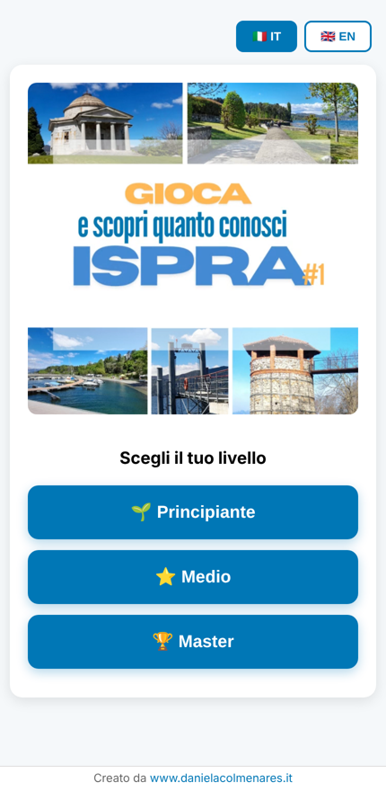
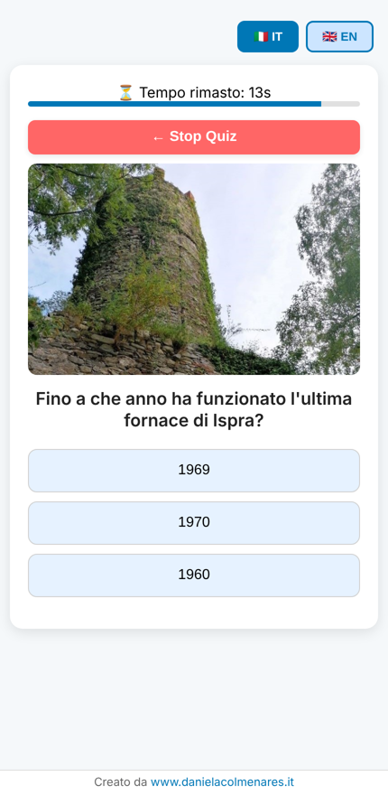

# Quanto conosci Ispra?

Un quiz bilingue per far conoscere un territorio giocando: il paese di Ispra, sul Lago Maggiore, con le sue fornaci, il lungolago, la storia e il Centro Comune di Ricerca europeo.

**[▶ Gioca alla demo](https://danielacolmenares.github.io/quanto-conosci-ispra/)**

*A bilingual (Italian/English) mobile-first quiz game to engage a local community with the history and places of Ispra, on Lake Maggiore. Pure HTML, CSS and JavaScript, no dependencies.*

<p>
  
  
</p>

---

## L'idea

Un sito di contenuti che racconta un territorio fa fatica a farsi leggere. Un gioco si fa giocare, si condivide e invita a tornare. *Quanto conosci Ispra?* trasforma curiosità e storia locale in una sfida breve, da fare con il telefono, che chi vive sul lago vuole vincere e chi è di passaggio vuole provare.

Il quiz è nato come **strumento di comunicazione**: per coinvolgere una comunità online, portare persone verso i contenuti e alimentare i profili social.

## Come si gioca

- **Tre livelli**: 🌱 Principiante, ⭐ Medio, 🏆 Master, 5 domande ciascuno
- **15 secondi** per ogni risposta, con il tempo che scorre in una barra
- **Un'immagine per ogni domanda**: luoghi, foto d'epoca, mappe
- **Un video per ogni momento**: introduzione al livello e commento finale, diverso in base al punteggio (complimenti, potenziale, "riprova") e una coppa per chi fa tutto giusto al livello Master
- **Italiano e inglese**: si cambia lingua con un tocco, e cambiano testi, domande e video

Le domande vanno dalla geografia ("Dove si trova Ispra?") alla storia locale ("Fino a che anno ha funzionato l'ultima fornace?", "Come si chiamava il primo reattore nucleare di ricerca italiano?").

## Le scelte di comunicazione

- **Pensato per il telefono**: è lì che arrivano le persone dai social. Video a schermo intero, pulsanti grandi, margini per le aree sicure dello schermo.
- **Difficoltà a gradini**: il livello Principiante è alla portata di tutti, il Master è pensato per mettere alla prova anche chi è di Ispra. Ognuno trova il suo livello.
- **Un tono personale**: un personaggio in video accoglie, incoraggia e prende in giro con simpatia ("almeno per oggi non posso considerarti un vero isprese").
- **Bilingue da subito**, perché il lago è pieno di turisti e di chi lavora nelle istituzioni internazionali.
- **Fatto per essere condiviso**: anteprime Open Graph e Twitter Card, così il link sui social mostra copertina e titolo. Per il lancio sono stati preparati reel, storie e video per Facebook e Instagram, oltre a una pagina che apre il quiz nel browser esterno invece che dentro l'app.

## Com'è fatto

Una sola pagina HTML con CSS e JavaScript, **senza librerie né server**: si pubblica su qualsiasi hosting statico, compreso GitHub Pages.

```
index.html          il gioco: interfaccia, testi nelle due lingue, timer, logica
data/it/  data/en/  le domande, un file JSON per livello
img/                copertina e un'immagine per domanda
video/it/ video/en/ introduzione, avvio dei livelli e commenti finali
docs/               immagini per questo README
```

**Le domande stanno nei dati, non nel codice.** Ogni domanda è un oggetto JSON:

```json
{
  "question": "Dove si trova Ispra?",
  "media": { "question": "img/principiante_q1_domanda.jpg" },
  "options": ["Sul Lago di Como", "Sul Lago Maggiore", "Sul Lago di Garda"],
  "correct": 1
}
```

Si aggiunge un livello o una domanda, o si adatta il quiz a un altro paese, senza toccare la logica del gioco.

## Provarlo in locale

I file JSON si caricano via HTTP, quindi serve un piccolo server:

```bash
python -m http.server 8000
# poi apri http://localhost:8000
```

---

Ideato, scritto e sviluppato da **Daniela P Colmenares** · [danielacolmenares.it](https://www.danielacolmenares.it)
